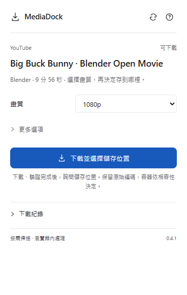
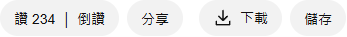

<div align="center">


# MediaDock

**選畫質，下載，存到你要的位置。**

Edge／Chrome 127+ · 繁體中文 · 0.4.1 開發中，尚未發布

**[下載擴充功能 ZIP](https://github.com/OverGreen996/MediaDock/releases/download/v0.4.0/MediaDock-Extension.zip)** · [版本與校驗值](https://github.com/OverGreen996/MediaDock/releases/tag/v0.4.0) · [驗證紀錄](VALIDATION.md)

</div>

**已知問題：目前公開的 0.4.0 部分一般 YouTube 影片點下載後回應 403，Bili 也有來源失敗回報。0.4.1 正在處理；已重現 `mqK1eU5k2CQ` 的 403，尚未解決。下方 ZIP 仍是 0.4.0，不要把重新安裝舊版當作修復。**

解壓、載入擴充功能，就能開始。所有媒體處理在瀏覽器內完成；使用者無須安裝 Node.js、Python、FFmpeg、yt-dlp 或本機助手。

- **YouTube／Bilibili**：讀取目前影片，列出實際可用畫質，支援 Shorts 與 Bili 當前分 P。
- **YouTube 頁面按鈕**：一般播放頁的「分享」旁加入「下載」；Shorts 放在分享操作列。點擊開啟同一個面板，配色跟隨網站，切換影片會更新。
- **其他網站**：按需掃描並列出找到的影片、音訊、HLS／DASH，選擇要保存的來源。
- 精簡的淺色／深色面板；格式、僅音訊與 Bili 登入選項收在「更多選項」。

## 安裝

1. [下載 MediaDock-Extension.zip](https://github.com/OverGreen996/MediaDock/releases/download/v0.4.0/MediaDock-Extension.zip)，解壓縮。
2. 開啟 `edge://extensions` 或 `chrome://extensions`，啟用「開發人員模式」，點「載入解壓縮」。
3. 選擇解壓後的 **`MediaDock-0.4.0` 資料夾**，其中應直接包含 `manifest.json`。確認顯示 **0.4.0**，固定圖示到工具列。

這是手動載入版，尚未上架瀏覽器擴充商店。瀏覽器不允許 ZIP 自動安裝，仍需上述載入步驟。ZIP 的 SHA-256 見 [SHA256SUMS.txt](https://github.com/OverGreen996/MediaDock/releases/download/v0.4.0/SHA256SUMS.txt)。

GitHub 原始碼下載包則選擇裡面的 `extension/` 資料夾。YouTube 已開啟的頁面請重新整理，頁面下載按鈕才會出現。

從 0.3 升級：移除舊版擴充，再載入 0.4；移除擴充會清除舊下載紀錄，已儲存的影片仍保留。0.4 不使用舊本機助手。0.3 的程式與安裝說明保留在 [舊版 Release](https://github.com/OverGreen996/MediaDock/releases/tag/v0.3.0)。固定擴充 ID：`fhjcedbbonnlkilcklhodjejolannode`。

## 使用

0.4.1 開發中補上「API 有畫質，但媒體網址不能下載」的處理：先讀取所選影音的開頭與結尾，避免只憑開頭可讀就誤判完整來源可用；YouTube 失敗時嘗試另一個客戶端及同畫質 HLS，Bili 優先讀取目前播放器的登入影音資料，並補上 WBI 查詢、CDN 備援與下載期間的切換。只嘗試同一來源與所選畫質，失敗會明確報錯。

新增故障測試：刻意令 YouTube 直接網址回傳 403，仍完成同一影片的 1080p HLS 下載與全部影音解碼；Bili 主要 CDN 無法使用時，備援流程也完成公開 480p 下載。**實際回報的 YouTube `mqK1eU5k2CQ` 沒有可用備援，完整下載仍失敗。** 通過的示例不能代表這個問題已解決，也不代表所有網站、帳號與地區均可下載。

開啟影片頁，點 MediaDock，選畫質後按「下載並選擇儲存位置」。**先下載、合併與完整驗證，完成後才跳出瀏覽器的另存新檔視窗。** 沒有通過驗證的來源不會提供儲存。

關閉面板仍會繼續下載；重新點圖示可查看進度、取消與下載紀錄。請保持瀏覽器開啟，重新載入、停用或移除擴充會中斷工作。最多同時兩項下載。4K、長影片的完整解碼會多花時間，並需要足夠的瀏覽器暫存空間。

畫質依來源實際提供，不會把低畫質升頻當成 4K。預設選擇不超過 1080p 的可用畫質，也可選「最佳可用畫質」。Shorts 顯示短邊畫質與實際寬高，例如「2160p／4K · 2160 × 2964」，保存原始尺寸。

Bilibili 的「使用此分頁的 Bilibili 登入權限」預設勾選，使用同一瀏覽器既有的網站登入狀態；**不讀取、匯出或保存 Cookie 值**。畫質取決於影片與帳號權限，登入不代表一定能取得全部畫質。請開啟要下載的分 P，不批次下載播放清單。此版尚未實測使用者登入後的 1080p／會員畫質。

保留來源的影音編碼，合併成相容的 MP4 或 WebM，沒有重新編碼或降低畫質。「僅音訊」保存原始音訊為 M4A 或 WebM；本版沒有 MP3 轉檔與字幕下載。高畫質的 VP9／AV1 等原始編碼，需要播放器支援；瀏覽器無法完整解碼的來源會報錯，不會假稱通過驗證。

## 掃描其他網站

先播放影片，再點圖示或「重新掃描」。清單可列出頁面媒體、連結與同源 iframe 中的來源。若未找到，可選「啟用串流偵測」並授權，重新播放／載入，再重新掃描。偵測只記錄啟用的分頁；停止偵測清除該分頁清單。下載其他網域的媒體時，另按來源要求網站存取權。

支援一般 MP4／WebM／音訊、**未加密的 HLS 隨選串流**與**部分靜態 DASH**。DASH 支援單一 Period 的 BaseURL、SegmentTemplate／SegmentTimeline、SegmentList（無 byte range）等形式。未支援的格式會明確報錯。網域辨識只提供網站標籤，不代表每個網站都能下載；其他網站沒有宣稱全面支援的專用解析器。

DRM、加密串流、直播、blob 網址本身、需額外驗證、反爬或未授權內容可能無法保存。一般媒體來源以匿名請求下載，無法沿用其他網站的私人登入權限；Bili 專用解析是上述登入流程的例外。清單可能包含廣告或預告，請選擇正確來源。請下載你有權保存的媒體。

## 驗證與實測

YouTube 下載前重新核對影片 ID；Bilibili 核對 BV／AV、CID、分 P 與目前網址，再選擇精確畫質。下載後檢查影音軌道、來源片長、實際尺寸、分段完整性，完整解碼影音至片尾，並計算 SHA-256。只在瀏覽器確認檔案儲存完成後，紀錄才顯示「驗證完成」。

這些檢查確認所選來源與媒體完整性，不能自動辨識每個一般網頁資源是否為主片，也不能保證所有第三方播放器。SHA-256 用於確認已驗證及儲存的位元組一致，並不是網站提供的內容認證。

2026-10-07，以真正的 Edge MV3 擴充完成以下下載；實際 API、CDN 媒體、瀏覽器內合併／完整解碼及已儲存檔案播放均通過：

| 來源 | 實際檔案 | 結果 |
|---|---|---|
| YouTube 1440p | 2560 × 1440 · MP4／VP9／AAC | 原始編碼，來源核對、全片影音解碼、Edge 播放通過 |
| YouTube 4K | 3840 × 2160 · MP4／VP9／AAC | 原始編碼，上述驗證通過 |
| YouTube Shorts | 2160 × 2964 · MP4／VP9／AAC | 保留直向尺寸，上述驗證通過 |
| Bilibili 公開影片 | 480p · MP4／H.264／AAC | 測試瀏覽器未登入，公開可用畫質驗證通過 |

另通過 **22 項核心測試**與真實瀏覽器 MP4／HLS／DASH 案例；偽裝 MP4 的 HTML、截斷檔案會失敗且不儲存；取消、暫存清理與閒置引擎釋放均通過。Chrome 正式版及 Bili 已登入 1080p 尚未實測。完整方法與限制見 [VALIDATION.md](VALIDATION.md)。

## 介面預覽

<picture>
  <source media="(prefers-color-scheme: dark)" srcset="docs/images/popup-dark.png">
  
</picture>



面板使用固定測試資料；按鈕由真實 Edge 擴充功能注入測試頁。截圖不是所有影片都可提供該畫質的保證。

## 資源與隱私

沒有下載伺服器、遙測、第三方字型或遠端執行程式。平台解析短暫快取 90 秒，最多 12 筆；下載紀錄僅在瀏覽器本機保存，最多 100 筆。紀錄包含來源網址、識別、驗證摘要與檔案指紋。

一般網站按需掃描，不載入常駐內容腳本；YouTube 的頁面按鈕使用輕量事件／DOM 觀察，沒有定時輪詢。只在開始下載時建立背景媒體工作頁與 Worker，串流寫入瀏覽器私有暫存空間；工作結束清除暫存，閒置約 10 秒釋放媒體引擎。非正常中斷留下的暫存會在下次下載時清理。清除紀錄不刪除影片，移除擴充可直接從瀏覽器操作。

網站 API 與媒體網址可能變動，之後可能需要更新擴充。此版沒有簽名／JavaScript challenge 解碼器；目前支援的 YouTube 客戶端若無法提供直接影音網址，會報錯。

## 開發

使用者載入預先建置的 `extension/` 即可。以下工具只供開發與測試：Node.js、pnpm、已安裝的 Edge；FFmpeg 只用於生成可重現的測試媒體，不包含於擴充與發行 ZIP。

```powershell
pnpm install --frozen-lockfile
pnpm run build
pnpm test
pnpm run test:ui
pnpm run test:youtube-button
pnpm run test:fixtures
powershell -NoProfile -ExecutionPolicy Bypass -File scripts/Build.ps1
```

原始碼：`extension/`（面板／平台解析）、`src/engine.js`（瀏覽器媒體引擎）；`engine.bundle.js` 已隨原始碼與 ZIP 提供。依賴固定版本，授權與對應原始碼下載見 [THIRD-PARTY.md](THIRD-PARTY.md)。真實平台與播放測試見 [VALIDATION.md](VALIDATION.md)。影片、瀏覽器設定檔、登入資料與測試暫存不包含於儲存庫或發行包。
